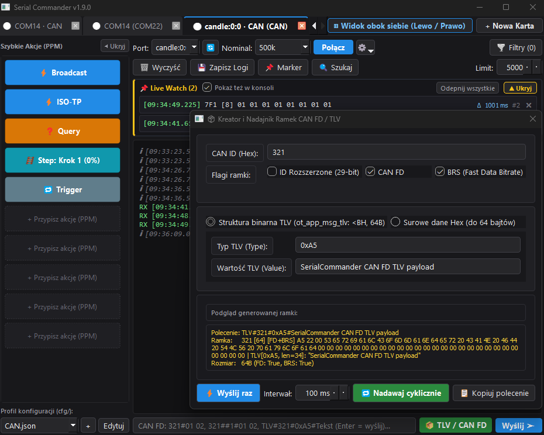
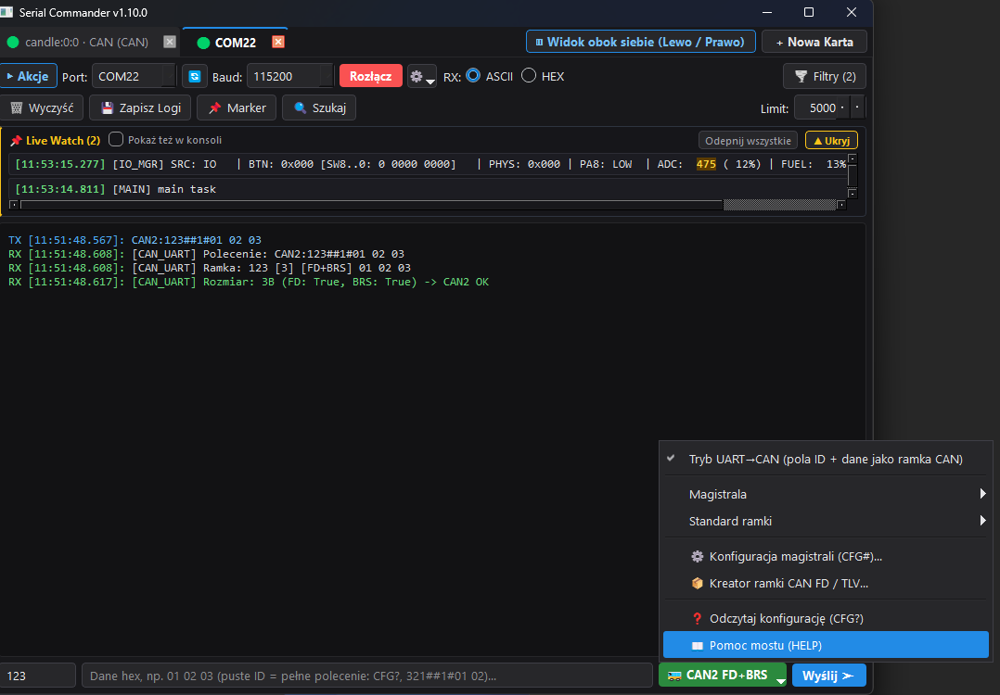

# Serial Commander v1.10.0 — Dokumentacja i Instrukcja Obsługi


**Serial Commander** to zaawansowany, wielowątkowy terminal diagnostyczny COM / HMI stworzony w technologii Python (`PyQt6`, `pyserial`, `python-can`), zaprojektowany specjalnie do debugowania systemów wbudowanych (STM32, ESP32, adaptery CANable slcan, sieci CAN, RS-485 oraz protokołów binarnych i ASCII).


---


## 1. Główny Interfejs i Ergonomia Pracy


Układ programu został zoptymalizowany pod kątem naturalnego skupienia wzroku podczas debugowania sprzętu:

1. **Pasek Zakładek (Góra):** Wyświetla otwarte sesje wraz z wizualnym statusem połączenia:

   * `🟢 COM22` — port aktywny (połączony),

   * `⚪ COM20` — port w spoczynku (rozłączony).

2. **Górny Pasek Połączenia i Narzędzi:** Zawiera konfigurację portu, prędkości, trybu odbioru (`ASCII` / `HEX`) oraz narzędzia konsoli (`🗑️ Wyczyść`, `💾 Zapisz Logi`, `📌 Marker`, `🔍 Szukaj`, `Limit linii`).

3. **Lewy Panel „Szybkie Akcje (PPM)”:** Zawiera 10 programowalnych przycisków, narzędzie zatrzymania pętli `⏹ Stop (N)` oraz wybór profilu `.json`. Panel można w każdej chwili zwinąć przyciskiem **`◀ Ukryj`**, oddając 100% szerokości dla konsoli.

4. **Sekcja `📌 Live Watch`:** Przypięte ramki telemetryczne odświeżane w czasie rzeczywistym nad głównym strumieniem logów.

5. **Dolny Pasek Komend (TX):** Umieszczony bezpośrednio pod najnowszymi logami. Obsługuje:

   * wysyłanie komend klawiszem `Enter`,

   * **historię wysłanych komend** pod strzałkami `↑` (Góra) oraz `↓` (Dół),

   * wybór formatu (`ASCII` / `HEX`) oraz znaku końca linii (`CRLF \r\n`, `LF \n`, `CR \r`, `Brak EOL`).


---


## 2. Wybór Portu COM i Prędkości Baudrate


* **Inteligentny `PortComboBox`:** W stanie spoczynku lista wyboru portu jest wąska (`82 px`) i pokazuje wyłącznie sam numer portu (np. `COM20`), oszczędzając miejsce na pasku narzędziowym. Po kliknięciu lista automatycznie rozszerza się do `340 px` i wyświetla pełną nazwę sterownika z systemu (np. `STMicroelectronics Virtual COM Port`, `USB-Enhanced-SERIAL CH343`).

* **Przycisk `🔄` i wykrywanie nowych portów:** Odświeża listę dostępnych w systemie portów COM w locie. Nowo podłączone urządzenia (np. wpięty konwerter USB-UART lub adapter CANable) są po rozwinięciu listy wyróżniane ciemnozielonym tłem, jasnym tekstem oraz etykietą **`✨ COMxx — Opis... [NOWY]`**. Ponowne kliknięcie `🔄` (gdy nie ma dalszych nowych portów) automatycznie usuwa podświetlenie.

* **Prędkość Baudrate:** Zawiera szereg standardowych prędkości aż do **`1000000` bps**. Na samym dole listy znajduje się opcja **`Własny...`**, która pozwala wpisać dowolną niestandardową prędkość transmisji.


---


## 3. Sterowanie Sprzętowe Liniami DTR / RTS i Reset MCU


Obok przycisku `Połącz` / `Rozłącz` znajduje się przycisk menu sprzętowego **`⚙️`**, przydatny podczas pracy z płytkami podłączonymi bezpośrednio przez konwerter USB-UART lub wbudowany debugger:

* **`Linia DTR (Data Terminal Ready)`** — ręczne wymuszenie stanu logicznego na pinie DTR.

* **`Linia RTS (Request To Send)`** — ręczne wymuszenie stanu logicznego na pinie RTS.

* **`🔄 Impuls Reset MCU (DTR/RTS 100ms)`** — generuje 100-milisekundowy impuls resetujący mikrokontroler, pozwalając uchwycić w konsoli logi startowe bootloadera bez sięgania ręką do przycisku Reset na płytce.


---


## 4. Programowalne Przyciski „Szybkie Akcje”, Zaawansowane Tryby i Liczniki Kroczące


> **Wskazówka:** Aby skonfigurować lub edytować dowolny z 10 przycisków po lewej stronie, **kliknij na niego Prawym Przyciskiem Myszy (PPM)**. Po najechaniu kursorem na skonfigurowany przycisk wyświetli się dymek (Tooltip) z podglądem przypisanych ramek.


Każdy przycisk może pracować w jednym z **7 trybów** (w formacie `ASCII`, `HEX` lub `CAN`):

1. **`⚡ Push` (Niebieski):** Pojedyncze kliknięcie wysyła zdefiniowaną ramkę `TX` jeden raz.

2. **`🔘 Toggle` (Zielony ON / Czerwony OFF):** Przełącznik dwustanowy z **weryfikacją sprzętową ACK**. Kliknięcie wysyła ramkę `TX ON` lub `TX OFF`, ale **kolor i stan przycisku na panelu zmieni się TYLKO wtedy, gdy urządzenie odeśle zdefiniowaną ramkę potwierdzenia (`ACK ON` / `ACK OFF`)**.

3. **`⏳ Hold` (Pomarańczowy):** Wysyła ramkę `TX (Wciśnięty)` w momencie naciśnięcia przycisku myszą oraz `TX (Puszczony)` w momencie zwolnienia przycisku.

4. **`🔁 Trigger` (Szaroniebieski / Pomarańczowy w pracy):** Generator pętli asynchronicznej. Po kliknięciu cyklicznie wysyła ramkę `TX` co zadany interwał (w milisekundach) aż do ponownego kliknięcia.

5. **`📜 Macro` (Fioletowy):** Posiada powiększone, wieloliniowe pole tekstowe do definiowania sekwencji komend i ramek rozdzielonych średnikami `;` lub nowymi liniami, z obsługą opóźnień czasowych `sleep(milisekundy)`, np.:

   ```text

   187#01 02

   sleep(100)

   187#00

   ```

6. **`❓ Query` (Bursztynowy `#d97706` / Żółty `#fcc419` w oczekiwaniu):** Zapytanie diagnostyczne Request-Response z precyzyjnym pomiarem czasu odpowiedzi i timeoutem (ms):

   * Po kliknięciu wysyła komendę `TX` i przechodzi w stan oczekiwania (przycisk zmienia barwę na jaskrawożółtą `⏳ Nazwa...`).

   * Jeśli urządzenie odeśle odpowiedź pasującą do wzorca `Wzorzec RX` (dopasowanie `fnmatch` dla tekstu/hex lub klucza CAN `ID#...*`), przycisk natychmiast błyska na zielono i podaje zmierzony czas reakcji: **`✔ Nazwa (42ms)`**.

   * Jeśli czas minie bez odpowiedzi, przycisk błyska na czerwono z ostrzeżeniem: **`✖ Nazwa [TIMEOUT]`**.

7. **`🪜 Step` (Morski Cyjan `#1098ad`):** Przełącznik sekwencyjny / wielostanowy. W dedykowanej tabeli kroków definiujesz etykiety i ramki (np. Krok 1: Wyłączony, Krok 2: Tryb Eko, Krok 3: Pełna moc). Każde kliknięcie wysyła ramkę kolejnego kroku, aktualizuje etykietę przycisku (**`🪜 Nazwa: Eko`**) i zapętla się do początku.


### Dynamiczne Liczniki Kroczące `{CNT}` i `{SEQ}`

W polach nadawczych `TX` wszystkich typów przycisków (a także w pętli `Trigger` czy skryptach `Macro`) można wstawiać inteligentne tokeny liczników:

* **`{CNT}`** lub **`{SEQ}`** — automatyczny licznik kroczący od `0` do `255`, inkrementowany przy każdej wysłanej ramce danego przycisku.

* **`{CNT:min-max}`** — licznik dziesiętny w zadanym przedziale, np. `{CNT:1-10}` lub `{CNT:00-99}` (automatycznie zachowuje zera wiodące na podstawie długości wartości minimalnej).

* **`{CNT:00-FF:X}`** — pełny 1-bajtowy licznik szesnastkowy HEX (`00` do `FF`, dokładnie 2 cyfry hex).

* **`{CNT:00-0F:X}`** (lub `{CNT:0-15:2X}`) — 1-bajtowy licznik HEX o zakresie 0..15 (`00` do `0F`, dokładnie 2 cyfry hex).

* **`0{CNT:0-15:X}`** — 4-bitowy półbajt (`0` do `F`) dopełniony zerem wiodącym do wymaganych 2 cyfr hex.


> [!IMPORTANT]

> **Zasada parzystości cyfr HEX w CAN:** W magistrali CAN każdy bajt danych składa się ściśle z **2 cyfr szesnastkowych** (np. `00`, `0F`, `7A`). Wpisanie pojedynczej cyfry (np. samego 4-bitowego `{CNT:0-15:X}` dającego 1 znak) bez dopełnienia spowoduje nieparzystą liczbę cyfr hex w danych (błąd `nieparzysta liczba cyfr hex w danych`). Dla pełnego bajtu o zakresie 0..15 zawsze stosuj **`{CNT:00-0F:X}`** lub dwubajtowy **`{CNT:00-FF:X}`**!


### Intuicyjny Pomocnik Liczników i Walidator na Żywo

W oknie edycji przycisku (`ButtonEditDialog`):

* **Pasek szybkiego wstawiania (Chips):** Przyciski `+ 1B HEX {CNT:00-FF:X}`, `+ 1B 0..15 {CNT:00-0F:X}`, `+ Półbajt 0{CNT:0-15:X}`, `+ Dec {CNT}` jednym kliknięciem wstawiają poprawny, sprawdzony znacznik bezpośrednio do bieżącego pola TX.

* **Podgląd na żywo (Live Preview):** U dołu okna edycji wyświetla się na bieżąco rozwinięta ramka z symulacją sekwencji kolejnych wartości (`187#01000000 ➔ 187#01010000 ➔ ...`).

* **Walidacja w locie i Przycisk Napraw:** Jeśli popełnisz błąd (np. nieparzysta liczba cyfr w ramce `187#01{CNT:0-15:X}0000`), walidator natychmiast wyświetla czerwone ostrzeżenie oraz przycisk **`⚡ Napraw: zamień na {CNT:00-0F:X}`**, który jednym kliknięciem koryguje ramkę do w pełni poprawnej postaci.


### Narzędzie „⏹ Stop (N)” (Zatrzymanie Wszystkich Pętli)

Gdy uruchomisz jeden lub więcej przycisków cyklicznych **`🔁 Trigger`**, w nagłówku panelu „Szybkie Akcje” automatycznie pojawia się czerwony przycisk **`⏹ Stop (N)`** (gdzie `N` to liczba aktualnie pracujących pętli). Kliknięcie go jednym ruchem natychmiast zatrzymuje wszystkie aktywne generatory, po czym przycisk samoczynnie znika.


> **Inteligentne przykłady (Click-to-Clear):** Podczas konfiguracji nowego przycisku pola są automatycznie uzupełniane przykładową ramką. Wystarczy kliknąć myszą w pole, a przykład natychmiast zniknie, umożliwiając bezpośrednie wpisanie własnych danych bez konieczności zaznaczania i kasowania tekstu.


Kliknięcie **`Usuń / Wyczyść`** w oknie edycji natychmiastowo resetuje przycisk do stanu nieużywanego (`+ Przypisz akcję (PPM)`).


---


## 5. Praca z Konsolą: Zaznaczanie Tekstu i Menu Kontekstowe (PPM)


> **Ważne:** Aby w menu kontekstowym (PPM) pojawiły się opcje szybkiego dodawania do Filtra oraz Parsera, **najpierw zaznacz myszką interesujący Cię fragment tekstu w konsoli logów**, a następnie kliknij Prawym Przyciskiem Myszy.


Dostępne akcje w menu PPM konsoli:

* **`📌 Przypnij do Live Watch (klucz)`** — automatycznie wyciąga identyfikator modułu (np. `CAN2_TX` lub `[IO_MGR]`) i przypina go do tablicy telemetrycznej u góry ekranu.

* **`🌪️ Dodaj do Filtra (*tekst*)`** — automatycznie otacza zaznaczony fragment gwiazdkami (np. `*CAN2_TX*`), kopiuje go do schowka, rozwija szufladę filtrów i wkleja gotowy wzorzec.

* **`🧩 Dodaj do Parsera (*tekst*)`** — wkleja zaznaczony fragment z gwiazdkami `*...*` jako wzór parsera i ustawia kursor bezpośrednio w polu tekstu zastępczego.

* **`🔍 Szukaj w logach (Ctrl+F)`** — otwiera pływającą wyszukiwarkę z licznikiem trafień i nawigacją `▲` / `▼`.

* **`▼ Wróć do najnowszych logów (Auto-scroll)`** — gdy przewiniesz konsolę w górę, automatyczne przewijanie zatrzymuje się, abyś mógł spokojnie analizować historię. Kliknięcie niebieskiego pływającego przycisku u dołu przywraca podgląd na żywo.


---


## 6. Moduł `📌 Live Watch` — Telemetria i Błyski Zmian


Moduł **Live Watch** pozwala obserwować często odświeżane ramki statusowe w jednym stałym wierszu u góry konsoli (jak w analizatorach magistrali CAN):

* **Dwa sposoby przypinania:**

  1. **Ręcznie z GUI:** Kliknij PPM na linię w konsoli -> `📌 Przypnij do Live Watch`.

  2. **Automatycznie z kodu mikrokontrolera (`@`):** Jeśli wyślesz po UART linię poprzedzoną znakiem `@` (np. `@[IO_MGR] BTN: 0x000 | ADC: 514`), program sam rozpozna prefiks `[IO_MGR]`, przypnie go do Live Watch i usunie znak `@`.

* **Podświetlanie zmian (Token Diffing):** Program dzieli wiadomość na pojedyncze wartości i porównuje z poprzednim stanem. Stały tekst pozostaje szary, a **tylko te wartości, które uległy zmianie (np. `531` i `13%`), błyskają przez 750 ms na złoto-pomarańczowo**.

* **Ukrywanie w głównym logu:** Przypięte ramki są domyślnie wycinane z głównego okna konsoli poniżej, aby nie powodować przewijania innych logów. Zaznaczenie opcji **`Pokaż też w konsoli`** przywraca ich podwójne wyświetlanie.

* **Ergonomia i limit 70%:** Przycisk **`▲ Ukryj`** po prawej stronie pozwala zwinąć listę przypięć. Jeśli liczba przypiętych wierszy przekroczy **70% wysokości konsoli**, automatycznie włącza się suwak przewijania.


---


## 7. Filtry RX, Parsery oraz Tryb `⚠ ZAPORA` (Whitelist)


Kliknięcie przycisku **`🌪️ Filtry (N)`** rozwija szufladę szybkiego zarządzania ruchem przychodzącym:

* **Filtry RX (`Ukryj` / `Koloruj` / `Dozwolony`):**

  * `Ukryj` — całkowicie ignoruje linie pasujące do wzorca (np. `*main task*`).

  * `Koloruj` — wyróżnia pasujące logi jednym z 16 kolorów.

  * `Dozwolony (Whitelist)` — włącza **Tryb Zapory (`⚠ ZAPORA`)**. Na górnym pasku zapala się czerwony przycisk ostrzegawczy, a terminal odrzuca wszystkie logi poza tymi, które pasują do reguł Whitelist.

* **Parsery Payloadu:** Pozwalają zastąpić surowe ramki (np. `*AA 01*`) czytelnym opisem (np. `[START SYSTEMU]`) wyświetlanym w złotym kolorze.


W oknach **Menadżer Filtrów** oraz **Menadżer Parserów** możesz w każdej chwili włączać i wyłączać poszczególne reguły za pomocą checkboxa **`Aktywny`**, sortować je klikając w nagłówki kolumn lub edytować.


---


## 8. Symetryczny Widok Podzielony (Split View 50% / 50%)


Gdy otworzysz dwie karty (lub klikniesz przycisk **`◫ Widok obok siebie (Lewo / Prawo)`**), program przechodzi w tryb równoległej pracy na dwóch portach COM:

* **Idealna symetria 50% / 50%:** Okno automatycznie rozszerza się do `1440 px`, a obie karty zajmują dokładnie po połowie ekranu.

* **Skrajne położenie paneli bocznych:** Panele przycisków domyślnie zwijają się na zewnętrzne krawędzie okna: **`▶ Akcje`** na lewym skraju dla lewej karty oraz **`Akcje ◀`** na prawym skraju dla prawej karty.


Po rozwinięciu paneli szybkich akcji znajdują się one po przeciwnych, skrajnych stronach ekranu, dzięki czemu obie konsole logów zawsze sąsiadują bezpośrednio ze sobą w centrum.


---


## 9. Przełączanie Kart w Widoku Podzielonym (Obsługa 3+ Kart)


Gdy masz otwartych więcej niż 2 karty (np. 3 lub 4 porty COM jednocześnie):

* **Wybór karty bezpośrednio w miejscu nazwy profilu:** Kliknij na nazwę portu/profilu w nagłówku lewego lub prawego okna (np. **`[LEWA] 🟢 COM22 — Profil: COM22.json ▾`**).

* **Brak duplikatów w menu:** Rozwinięta lista wyświetla wyłącznie pozostałe otwarte karty (karta aktualnie widoczna w tym oknie jest ukryta na liście).

* **Zamiana miejscami (`Swap ⇄`):** Wybór karty przypisanej obecnie do drugiej połowy ekranu (lub kliknięcie przycisku **`⇄ Zamień miejscami`** na górnej belce) błyskawicznie zamienia miejscami lewą i prawą kartę.

* **Powrót do pojedynczego okna:** Kliknięcie **`🗂️ Widok zakładek (1 okno)`** przełącza interfejs z powrotem na klasyczne zakładki i automatycznie zmniejsza szerokość okna głównego do kompaktowego rozmiaru pojedynczej karty (`940 px`).


---


## 10. Tryb Magistrali CAN (Adapter CANable / slcan)


W wersji **1.7.0** aplikacja Serial Commander zyskała natywną obsługę magistrali CAN za pośrednictwem popularnych adapterów **CANable** (lub kompatybilnych z firmware `slcan` udostępniających wirtualny port COM).


### Konfiguracja i Połączenie z CAN

1. Podłącz adapter CANable do komputera przez USB. Zostanie wykryty jako standardowy port COM (np. `COM20`).

2. Kliknij przycisk **`Edytuj`** obok profilu konfiguracyjnego i przejdź do zakładki **`Połączenie`**.

3. Jako **Typ połączenia** wybierz **`CAN – CANable (slcan)`**.

4. Wybierz prędkość transmisji **Bitrate CAN** (standardowe prędkości: `10k`, `20k`, `50k`, `83.3k`, `100k`, `125k`, `250k`, `500k`, `750k`, `1M`).

5. Opcjonalnie włącz:

   * **`Tryb nasłuchu (Listen-only)`** — adapter nie wysyła bitów ACK ani ramek błędów (idealne do bezpiecznego monitorowania magistrali pojazdu lub maszyny bez zakłócania ruchu).

   * **`Automatycznie przypinaj każde nowe ID do Live Watch`** — automatyczne monitorowanie wszystkich pojawiających się na magistrali identyfikatorów.

6. Kliknij **`Zapisz Ustawienia`**. Pasek karty automatycznie dostosuje się do trybu CAN (przełącznik prędkości zmieni się na `Bitrate:`, a kontrolki tekstowe UART zostaną ukryte).

7. Kliknij **`Połącz`**. Przy pierwszym połączeniu profil zostanie automatycznie zapisany jako `COMxx_CAN.json`.


### Nadawanie Ramek CAN (Składnia `cansend`)

W polu wprowadzania komend u dołu lub w przyciskach szybkich akcji stosuj standardową składnię `ID#DANE`:

* `187#01 02 03 04` — ramka standardowa (11-bit ID `0x187`, 4 bajty danych, spacje są dozwolone).

* `187#01020304` — ta sama ramka w postaci zwartej bez spacji.

* `18FEF100#AABB` — ramka rozszerzona (29-bit ID `0x18FEF100`, 2 bajty danych).

* `65A#R` lub `65A#R4` — ramka zdalna RTR (z opcjonalnym kodem DLC).

* `3D0#` — ramka z zerową długością danych (DLC = 0).


### Telemetria Live Watch w Trybie CAN

W trybie CAN panel **Live Watch** działa jak profesjonalny analizator magistrali:

* **Sortowanie według ID:** Ramki są automatycznie uporządkowane rosnąco według CAN ID (najpierw ramki 11-bit, potem 29-bit).

* **Pomiar czasu cyklu ($\Delta t$):** Obok licznika aktualizacji `#N` wyświetlany jest w czasie rzeczywistym czas cyklu od poprzedniej ramki o tym samym ID (np. `Δ   100 ms`).

* **Błysk Zmian Bajtów:** Zmienione bajty w ramce podświetlają się na złoto-pomarańczowo na 750 ms, pozwalając natychmiast dostrzec zmienne telemetryczne (np. odczyty czujników, liczniki alive).

* **Odpinanie:** Kliknięcie `✕` odepnie dany identyfikator, a sesyjny mechanizm zapamięta wybór i nie będzie go ponownie automatycznie przechwytywał.


### Przyciski Szybkich Akcji i Potwierdzenia ACK w CAN

* **Format TX zablokowany na CAN:** W profilu magistrali CAN pole wyboru formatu jest na stałe zablokowane na **`CAN`**, co chroni przed przypadkowym wysłaniem niesformatowanych ciągów znaków.

* **Ramka informacji o składni:** W oknie edycji przycisku znajduje się dedykowany panel wyświetlający schemat składni (`ID#DANE`, `65A#R`, wzorce ACK `581#01*`) oraz opis działania wybranego trybu.

* **Wypełnianie przykładową ramką (Click-to-Clear):** Każde pole nowego przycisku jest fabrycznie wypełnione poprawną ramką CAN (np. `187#01 02 03 04`, `187#01`, `581#01*`). Kliknięcie myszą w pole natychmiast czyści tekst przykładu, umożliwiając wpisanie własnego identyfikatora.

* **Powiększone pole trybu `📜 Macro`:** Edytor sekwencji makra jest pełnowymiarowym polem tekstowym, w którym komendy można wpisywać wygodnie w kolejnych liniach lub rozdzielać średnikami (np. `187#01;\nsleep(100);\n187#00`).

* Dla przycisków **`🔘 Toggle`** możesz zdefiniować potwierdzenie ACK dopasowywane do odebranej ramki CAN za pomocą wzorców z gwiazdką, np.:

  * `TX ON`: `187#01`, `ACK ON`: `581#01*`

  * `TX OFF`: `187#00`, `ACK OFF`: `581#00*`

  * `ACK ON`: `581#` (dopasowanie do dowolnej ramki z ID `0x581`).

* Przycisk **`❓ Query`** w CAN umożliwia diagnostykę Request-Response (np. OBD2/UDS): wysyła ramkę zapytania `7DF#02 01 0D 00 00 00 00 00` i oczekuje na ramkę odpowiedzi pasującą do `7E8#*`, mierząc czas reakcji sterownika w milisekundach.

* Przycisk **`🪜 Step`** pozwala sekwencyjnie zmieniać parametry pracy urządzenia po magistrali CAN (np. Krok 1: `187#00`, Krok 2: `187#01`, Krok 3: `187#02`).

* **Liczniki sekwencji i Alive w CAN:** W polach `TX` ramek CAN możesz stosować tokeny `{CNT:0-15:X}` (4-bitowy licznik 0..F) lub `{CNT:00-FF:X}` (8-bitowy licznik 00..FF), np. `187#01 {CNT:0-15:X} 00`, co zapewnia automatyczną inkrementację licznika żywotności przy każdym nadaniu ramki.

* Przycisk **`🔁 Trigger`** działa w trybie CAN jako cykliczny generator ramki co zadany interwał w milisekundach (z możliwością zatrzymania wszystkich pętli przyciskiem `⏹ Stop (N)`).


---


## 11. Tryb Magistrali CAN FD i Protokół candleLight (STM32G4 / WinUSB)





W wersji **1.9.0** aplikacja zyskała wsparcie dla szybkiej magistrali **CAN FD** (Flexible Data-rate) za pośrednictwem adapterów sprzętowych **candleLight** (opartych m.in. na mikrokontrolerach STM32G4 z transceiverami CAN FD, pracujących pod sterownikiem **WinUSB**).


Aplikacja w pełni wspiera koegzystencję ramek klasycznych **CAN 2.0** oraz **CAN FD** na tej samej magistrali (zgodnie ze standardem ISO 11898-1:2015 dla kontrolerów CAN FD).


---


### Instrukcja Krok po Kroku: Jak Przygotować i Skonfigurować CANable do Pracy z CAN FD


Standardowo większość adapterów CANable opartych na układach STM32G4 trafia do użytkownika z oprogramowaniem układowym **`slcan`** (emulującym wirtualny port COM). Oprogramowanie to ograniczone jest wyłącznie do klasycznego standardu CAN 2.0 (do 8 bajtów danych). Aby odblokować pełne możliwości **CAN FD** (ramki do 64 bajtów oraz prędkości fazy danych do 2M, 4M lub 5 Mbps), należy przeprowadzić poniższą procedurę:


#### Krok 1: Wgranie Oprogramowania Układowego candleLight (Aplikacja HUD EDU Hacker)

1. **Wprowadzenie adaptera w tryb Bootloadera DFU:**

   * Odłącz adapter CANable od portu USB komputera.

   * Wciśnij i przytrzymaj mikroskopijny przycisk **`BOOT`** na płytce adaptera (lub w przypadku wersji ze zworkami załóż zworkę łączącą pin `BOOT0` z `3.3V`).

   * Trzymając wciśnięty przycisk `BOOT`, podłącz kabel USB do komputera. Dioda zasilania na płytce zaświeci się, lecz diody komunikacji pozostaną wygaszone.

   * Zwolnij przycisk `BOOT`. W systemie Windows urządzenie zgłosi się w trybie bootloadera DFU (jako `STM32 BOOTLOADER`).

2. **Flashowanie w programie HUD EDU Hacker:**

   * Uruchom aplikację **HUD EDU Hacker** (narzędzie do konfiguracji i programowania adapterów magistrali CAN).

   * Program powinien automatycznie wykryć podłączone urządzenie STM32 w trybie DFU.

   * Wskaż lub wybierz z listy wsad oprogramowania układowego **`candleLight`** przeznaczony dla mikrokontrolera STM32G4 (CANable 2.0).

   * Uruchom procedurę programowania pamięci Flash i poczekaj na komunikat potwierdzający pomyślny zapis.

   * Po zakończeniu flashowania odłącz adapter od USB i podłącz go ponownie (już **bez** trzymania przycisku BOOT).

   * Płytka uruchomi się w trybie roboczym z identyfikatorem sprzętowym `VID: 0x1D50, PID: 0x606F` jako kompozytowe urządzenie USB `candleLight`.


#### Krok 2: Podmiana Sterownika na WinUSB za Pomocą Programu Zadig

W systemie Windows urządzenie candleLight jest urządzeniem kompozytowym. Aby aplikacje w Pythonie (`libusb`, `candle-api`, `python-can`) miały bezpośredni dostęp do szybkich endpointów USB w przestrzeni użytkownika, konieczne jest przypisanie sterownika **WinUSB** do głównego interfejsu komunikacyjnego (`Interface 0`).


Narzędzie instalacyjne Zadig znajduje się bezpośrednio w katalogu projektu: **`programs/zadig-2.9.exe`**.


1. Uruchom program **`programs/zadig-2.9.exe`** z uprawnieniami administratora.

2. W górnym pasku menu kliknij **`Options`** i zaznacz opcję **`List All Devices`**.

3. **BARDZO WAŻNE (KLUCZOWY WARUNEK):** W menu **`Options`** upewnij się, że opcja **`Ignore Hubs or Composite Parents`** jest **ODZNACZONA** (odfajkowana). Jeśli ta opcja pozostanie zaznaczona, Zadig ukryje podrzędne interfejsy i uniemożliwi prawidłową instalację sterownika!

4. Rozwiń główną listę urządzeń i odszukaj:

   * **`candleLight (Interface 0)`** lub **`CAN FD Interface (Interface 0)`** (o identyfikatorze `1D50 606F 00` / `MI_00`).

   * *Uwaga:* Nie zmieniaj sterownika dla `Interface 1` (`MI_01`), ponieważ reprezentuje on interfejs DFU mikrokontrolera.

5. W polu docelowego sterownika (po prawej stronie zielonej strzałki) wybierz **`WinUSB`** (np. `v6.1.7600.16385`).

6. Kliknij przycisk **`Install Driver`** (lub **`Replace Driver`**) i zaczekaj na zakończenie instalacji (komunikat *"The driver was installed successfully"*).

7. **Weryfikacja w konsoli PowerShell:**

   Uruchom poniższe polecenie w terminalu, aby upewnić się, że sterownik jest aktywny:

   ```powershell

   Get-PnpDevice -PresentOnly | Where-Object { $_.InstanceId -match "VID_1D50&PID_606F" } | Format-Table Status, Class, FriendlyName, InstanceId, Service -AutoSize

   ```

   Dla interfejsu głównego `MI_00` w kolumnie `Service` musi widnieć **`WinUSB`**, a w kolumnie `Status` wartość **`OK`**.


#### Krok 3: Weryfikacja Działania Skryptami Diagnostycznymi Python (`tests/`)

Przed uruchomieniem aplikacji okienkowej Serial Commander warto uruchomić trzy przygotowane skrypty diagnostyczne weryfikujące kolejne warstwy stosu komunikacyjnego:


1. **Weryfikacja USB i biblioteki libusb (`tests/step1_usb_check.py`):**

   ```bash

   python tests/step1_usb_check.py

   ```

   * *Cel:* Sprawdza, czy Python ładuje bibliotekę `libusb-1.0.dll` przez `libusb_package` oraz nawiązuje kontakt z urządzeniem `1D50:606F`.

   * *Oczekiwany wynik:* Wyświetlenie numeru seryjnego mikrokontrolera STM32 oraz komunikat:

     `[SUKCES] Niskopoziomowy dostęp przez WinUSB + libusb działa!`


2. **Weryfikacja klasycznej ramki CAN 2.0 (`tests/step2_classic_can.py`):**

   *(Upewnij się, że do adaptera podłączona jest magistrala CAN z terminacją 120 Ω oraz zewnętrzny sniffer/analizator)*

   ```bash

   python tests/step2_classic_can.py

   ```

   * *Cel:* Otwiera magistralę z prędkością 500 kbps, nadaje 8-bajtową ramkę `0x123` (`11 22 33 44 55 66 77 88`) i nasłuchuje odpowiedzi przez 10 sekund.

   * *Weryfikacja:* Sprawdź, czy ramka `0x123` pojawiła się na zewnętrznym analizatorze oraz czy wysłana ze sniffera ramka zwrotna została odebrana w konsoli skryptu.


3. **Weryfikacja CAN FD i struktury TLV (`tests/step3_can_fd.py`):**

   ```bash

   python tests/step3_can_fd.py

   ```

   * *Cel:* Otwiera adapter w natywnym trybie CAN FD (Nominal Bitrate = 500 kbps, Data Bitrate = 2000 kbps, aktywna flaga BRS), pakuje dane w binarną strukturę `ot_app_msg_tlv` do 64 bajtów (`ID 0x321`, typ `0xA5`, tekst) i nadaje na magistralę.

   * *Weryfikacja:* Zewnętrzny analizator CAN FD powinien zarejestrować 64-bajtową ramkę z aktywną flagą BRS (Bit Rate Switch).


#### Krok 4: Konfiguracja i Praca w Serial Commander (GUI)

1. Uruchom aplikację:

   ```bash

   python gui.py

   ```

2. Kliknij **`Edytuj Profil`** na wybranej karcie i przejdź do zakładki **`Połączenie`**.

3. Jako **Typ połączenia** wybierz **`CAN / CAN FD – candleLight (WinUSB / gs_usb)`**.

4. Skonfiguruj parametry transmisji:

   * **Bitrate CAN (Nominal):** prędkość fazy arbitrażu (np. `500k`),

   * **Włącz CAN FD:** zaznacz pole wyboru (aktywuje ramki do 64 bajtów),

   * **Data Bitrate (CAN FD):** prędkość fazy danych (np. `1M`, `2M`, `4M` lub `5M`),
   * **Sample Point (CiA 601-1):** punkt próbkowania fazy danych (domyślnie **80.0%** – standard międzynarodowej specyfikacji CiA 601-1 dla CAN FD, zapewniający pełną zgodność zegarową z zewnętrznymi snifferami i sterownikami OEM).

5. Kliknij **`Zapisz Ustawienia`**.

6. Na liście portów rozwiń listę i wybierz wykryte urządzenie candleLight (np. `candle:0:0 — Candlelight 2.5 (SN: ...)`).
   > [!NOTE]
   > **Rozróżnianie urządzeń wolnych i zajętych (Współdzielenie ze snifferami/HUD ECU Hacker):**
   > Sterownik WinUSB wymaga wyłączności na urządzenie. Jeśli z adaptera candleLight korzysta równolegle inna aplikacja (np. HUD ECU Hacker, BusMaster czy skrypt w Pythonie):
   > * Port **nie zniknie** z programu – pojawi się na liście jako **`candle:0:0 🔒`** z ciemnoczerwonym podświetleniem i statusem `[ZAJĘTY przez inny program]`.
   > * W tytule karty pojawi się symbol kłódki: `🔒 candle:0:0 · CAN`.
   > * Próba kliknięcia *Połącz* wyświetli czytelny komunikat przypominający o konieczności rozłączenia w zewnętrznym oknie. Po zwolnieniu urządzenia i kliknięciu *Odśwież (⟳)* port natychmiast wraca do stanu gotowości (`🟢 Wolny`).

7. Kliknij **`Połącz`**.


---


### Składnia Ramek CAN FD i Struktura Binarna `ot_app_msg_tlv`

W terminalu komend, w przyciskach oraz w skryptach makr obsługiwane są trzy formaty:

1. **Automatyczny CAN FD:** `321#01 02 03 ...` — jeśli długość danych przekracza 8 bajtów (do 64B), ramka jest automatycznie nadawana w formacie CAN FD z aktywną flagą BRS.

2. **Jawna składnia CAN FD:** `321##1#01 02 03 ...` (flaga `1` = aktywny BRS, `0` = standardowy bitrate).

3. **Szybki generator TLV:** `TLV#<ID>#<TYP>#<DANE>` — automatycznie pakuje wiadomość w standardową binarną strukturę Little-Endian `<BH`:

   ```c

   typedef struct __attribute__((packed)) {

       uint8_t  type;       // 1 bajt (np. 0xA5)

       uint16_t length;     // 2 bajty (Little-Endian, długość danych)

       uint8_t  value[];    // Dane (dopełniane zerami do 64B)

   } ot_app_msg_tlv;

   ```

   Przykład: `TLV#321#0xA5#SerialCommander CAN FD TLV payload`


### Kreator i Nadajnik Ramek CAN FD & TLV (`📦 TLV / CAN FD`)

W trybie candleLight CAN FD obok dolnego pola komend dostępny jest dedykowany przycisk **`📦 TLV / CAN FD`**, który otwiera okno interaktywnego nadajnika:

* Pozwala wizualnie skonfigurować identyfikator CAN, flagi (`29-bit EXT`, `CAN FD`, `BRS`),

* Umożliwia wybór formatu: pakowanie TLV `<BH` lub surowy bufor Hex,

* Wyświetla podgląd na żywo wygenerowanej ramki bajt po bajcie,

* Oferuje nadawanie jednorazowe (`⚡ Wyślij raz`) oraz cykliczne (`🔁 Nadawaj cyklicznie`) z zadanym okresem w ms,

* Przycisk `📋 Kopiuj polecenie` pozwala jednym kliknięciem przenieść gotową komendę do schowka.


### Dekodowanie TLV w Konsoli i Panelu Live Watch

Wszystkie odebrane ramki o długości co najmniej 3 bajtów spełniające reguły nagłówka TLV są automatycznie dekodowane w locie i prezentowane w konsoli oraz w wierszach Live Watch:

```text

321 [64] [FD+BRS] A5 2A 00 53 65 72 ... | TLV[0xA5, len=42]: "SerialCommander CAN FD TLV payload"

```

W panelu Live Watch zmienione bajty nagłówka i wartości podświetlają się na złoto-pomarańczowo, a czas cyklu $\Delta t$ jest mierzony z dokładnością do ułamków milisekund.


### Obsługa Ramek CAN 2.0 oraz CAN FD w Przyciskach Szybkich Akcji (10 sztuk)

Podczas konfiguracji dowolnego kafelka (kliknięcie PPM -> Edytuj):

* **Wybór standardu ramki (`Standard CAN`):**

  * `Auto (ze składni / długości)` – automatyczne rozpoznawanie formatu na podstawie składni (`##1#`, `TLV#`) lub długości payloadu (> 8B).

  * `Klasyczny CAN 2.0 (maks. 8B, bez BRS)` – twardo wymusza nadawanie standardowej ramki CAN 2.0 (blokuje bit FD i BRS, zgłasza błąd walidacji przy danych powyżej 8 bajtów).

  * `CAN FD z BRS (do 64B, szybka faza danych)` – wymusza format CAN FD z przełączaniem prędkości na Data Bitrate (BRS=True) nawet dla krótkich ramek 1–8 bajtów.

  * `CAN FD bez BRS (do 64B, stała prędkość)` – nadaje ramkę CAN FD do 64B, ale cała transmisja odbywa się z prędkością nominalną (BRS=False).

  * `Struktura TLV (ot_app_msg_tlv, 64B)` – pakuje ramkę w 64-bajtową strukturę TLV z nagłówkiem `<BH`.

* **Szybkie szablony i konwerter formatu:**

  * `🚗 Szablon CAN 2.0 (8B)` – natychmiast wstawia 8-bajtową ramkę testową i przestawia tryb na CAN 2.0.

  * `⚡ Szablon CAN FD (64B)` – wstawia 64-bajtową ramkę z flagą BRS (`321##1#...`).

  * `📦 Szablon TLV (64B)` – wstawia składnię `TLV#321#0xA5#...`.

  * `🔄 Konwertuj do trybu` – jednym kliknięciem przekształca istniejącą ramkę w polu TX na format wybrany w selektorze `Standard CAN`.

* **Walidacja na żywo i inteligentna naprawa (`⚡ Napraw automatycznie`):**

  * Jeśli w trybie `Klasyczny CAN 2.0` wpisano więcej niż 8 bajtów lub użyto składni `##`, okno podświetla ostrzeżenie i wyświetla przycisk autofix pozwalający jednym kliknięciem przełączyć standard na CAN FD lub usunąć `##`.

* **Dynamiczne etykiety i tooltips:**

  * Po najechaniu kursorem na skonfigurowany przycisk dymek (tooltip) wyświetla precyzyjne oznaczenie standardu: `Typ: PUSH (CAN 2.0)`, `Typ: PUSH (CAN FD+BRS)` lub `Typ: TOGGLE (CAN FD TLV)`.


### Kontekstowe Dopasowanie Opcji Interfejsu (Serial vs slcan vs candleLight)

Aplikacja rygorystycznie dostosowuje widoczność i zachowanie kontrolek w zależności od aktywnego profilu transportu:

1. **Tryb Serial (UART / RS-232 / RS-485):**

   * Ukryte są wszelkie kontrolki specyficzne dla magistrali CAN (wybór Bitrate, przełącznik Listen-only, kreator TLV, formaty CAN w przyciskach).

   * W oknie edycji przycisku (`ButtonEditDialog`) typ ładunku ograniczony jest do `ASCII` i `HEX`.

2. **Tryb CANable slcan (CAN 2.0):**

   * Obsługuje wyłącznie standard **Klasyczny CAN 2.0** (maksymalnie 8 bajtów danych).

   * Wszelkie opcje CAN FD, faza danych BRS oraz kreator TLV są zablokowane i ukryte.

   * Dedykowany przycisk `📦 TLV / CAN FD` na dolnym pasku narzędziowym jest automatycznie ukryty.

   * W oknie edycji przycisku dostępne są tylko tryby zgodne z CAN 2.0 (`Auto`, `Klasyczny CAN 2.0`), a szablony CAN FD / TLV są ukryte. Walidator blokuje wpisanie więcej niż 8 bajtów i składnię `##`/`TLV#` (z opcją automatycznego przycięcia do 8 bajtów).

3. **Tryb candleLight (STM32G4 / WinUSB):**

   * Pełny dostęp do koegzystencji ramek CAN 2.0 oraz rozszerzonych ramek CAN FD i struktur TLV (do 64 bajtów).

   * Dostępny jest przycisk `📦 TLV / CAN FD` do wizualnego generowania i testowania pakietów TLV.

   * W oknie edycji przycisków odblokowane są wszystkie tryby transmisji (`Auto`, `CAN 2.0`, `CAN FD+BRS`, `CAN FD bez BRS`, `TLV`) wraz z pełnym zestawem szablonów i konwerterem.

### Porady Diagnostyczne i Konfiguracja Punktu Próbkowania (Sample Point)
1. **Odbiór Ramek i Widoczność w Konsoli:**
   * W trybie CAN domyślnie aktywna jest funkcja telemetrii can_watch_auto: True (każde nowe CAN ID otrzymuje stały wiersz z pomiarem Δt w panelu Live Watch u góry).
   * Opcja **Pokaż też w konsoli** (watch_print_in_console) jest domyślnie **włączona** – dzięki temu odebrane ramki są widoczne zarówno w stałym wierszu Live Watch, jak i strumieniowo w konsoli tekstowej na dole.
2. **Punkt Próbkowania (Sample Point CiA 601-1):**
   * Dla CAN FD z fazą danych 2 Mbps lub 4 Mbps zalecaną wartością jest **80.0%** (standard CiA 601-1). Zapewnia ona optymalną szerokość segmentu po punkcie próbkowania (t_seg2) oraz synchronizację kompensacji opóźnienia nadajnika (TDC).
   * Dla klasycznego CAN 2.0 (np. 500 kbps) można stosować zarówno **80.0%** jak i **87.5%** w zależności od wymagań zewnętrznego analizatora lub sieci pojazdu.
3. **Praca w Czystym Trybie Klasycznym CAN 2.0:**
   * Jeśli urządzenie candleLight ma komunikować się ze starszymi węzłami nieobsługującymi CAN FD, w oknie edycji profilu (ConfigEditDialog) wystarczy **odznaczyć** pole wyboru Włącz CAN FD. Adapter zostanie wówczas zainicjalizowany w czystym standardzie CAN 2.0 (blokada bitu FD na kontrolerze).

---

## 12. Most UART → CAN (Płytka Nucleo, Firmware `can_uart_bridge`)

Płytka Nucleo z firmware `can_uart_bridge` nadaje ramki CAN / CAN FD na **CAN1** lub **CAN2** na podstawie
jednej linii tekstu odebranej przez UART (VCP ST-LINK, 115200 8N1, CRLF). Serial Commander łączy się z nią
zwykłą kartą typu **Serial (UART)** – nie jest potrzebny adapter CAN ani biblioteka `python-can`.

```text
Serial Commander ──COM (VCP, 115200 8N1, CRLF)──► Nucleo (USART2) ──► CAN1 / CAN2
```



Tryb `UART→CAN` zwalnia z pamiętania składni poleceń: wpisujesz tylko **ID** i **dane**, a aplikacja sama
składa linię (np. `CAN1:321##1#01 02 03`), sprawdza ją i wysyła.

### Przycisk `🚌` na Dolnym Pasku

W profilu *Serial* obok przycisku `Wyślij ➤` znajduje się przycisk-menu `🚌 CAN`. Menu zawiera:

| Pozycja | Działanie |
|---|---|
| **Tryb UART→CAN** | Włącza pola `ID hex` + dane. Etykieta przycisku zmienia się na zieloną, np. `🚌 CAN1 FD+BRS`. |
| **Magistrala** → `CAN1` / `CAN2` | Prefiks `CAN1:` / `CAN2:` doklejany do każdej ramki. |
| **Standard ramki** | `Auto` (ze składni i długości), `Klasyczny CAN 2.0`, `CAN FD z BRS`, `CAN FD bez BRS`, `TLV`. Flagi są wpisywane w samą linię (`##1#`, `##0#`, `TLV#`), więc nie trzeba wysyłać `MODE#`. |
| **⚙ Konfiguracja magistrali (CFG#)...** | Dialog wyboru trybu i prędkości magistrali; wysyła `CFG#<bus>#<tryb>#<nominal>[#<data>]`. |
| **📦 Kreator ramki CAN FD / TLV...** | Kreator z osobnymi polami ID, flag FD/BRS, TLV i danych; nadawanie jednorazowe lub cykliczne (min. 50 ms). |
| **❓ Odczytaj konfigurację (CFG?)** | Stan obu magistral, liczniki błędów i UART. |
| **📖 Pomoc mostu (HELP)** | Skrócona składnia z firmware. |

Ustawienia mostu są zapisywane w profilu (`cfg/*.json`, klucz `uart_can_bridge`), łącznie z ostatnio użytym ID.

### Wysyłanie Ramki: Pola ID i Dane

Po włączeniu trybu na pasku pojawiają się dwa pola: **`ID hex`** (wąskie, po lewej) i **dane**.
Enter w dowolnym z nich wysyła ramkę. Pole ID nie jest czyszczone, więc kolejne ramki z tym samym ID wpisujesz
tylko w polu danych (strzałki `↑` / `↓` przywołują historię danych).

| ID | Dane | Standard | Linia wysłana do Nucleo |
|---|---|---|---|
| `321` | `01 02 03` | Auto | `CAN1:321#01 02 03` |
| `321` | `01 02 03` | CAN FD z BRS | `CAN1:321##1#01 02 03` |
| `18DAF110` | `11 22` | CAN FD bez BRS | `CAN1:18DAF110##0#11 22` |
| `321` | `01 02 … 0C` (12 B) | Auto | `CAN1:321##1#01 02 … 0C` (FD+BRS automatycznie) |
| `65A` | `R4` | Auto | `CAN1:65A#R4` (RTR) |
| `321` | `Hello` | TLV | `CAN1:TLV#321#0xA5#Hello` |
| *(puste)* | `CFG?` | – | `CFG?` (polecenie sterujące bez zmian) |
| *(puste)* | `CAN2:187#01` | – | `CAN2:187#01` (prefiks w tekście ma pierwszeństwo) |

* **Podgląd na żywo:** dymek nad polem danych pokazuje linię, która trafi do Nucleo (`➜ Nucleo: CAN1:...`).
* **Walidacja przed wysłaniem:** błędne ID lub dane (np. nieparzysta liczba cyfr hex, 9 B w trybie Classic,
  znaki spoza ASCII) są oznaczane czerwoną ramką. Po Enterze w konsoli pojawia się opis błędu, nic nie jest
  wysyłane, a wpisany tekst zostaje do poprawy.
* Linia jest zawsze wysyłana jako **ASCII + CRLF** – w trybie `UART→CAN` wybór `ASCII/HEX` i `EOL` jest ukryty.

### Konfiguracja Magistrali (CFG#)

Dialog `⚙ Konfiguracja magistrali` składa polecenie z list wyboru:

* **Magistrala:** `CAN1` / `CAN2`,
* **Tryb:** `Classic CAN 2.0`, `CAN FD bez BRS`, `CAN FD + BRS`,
* **Nominal:** `125k`, `250k`, `500k`, `1M`,
* **Data (BRS):** `1M`, `2M`, `4M`, `8M` (aktywne tylko dla `CAN FD + BRS`).

Przykład: `CAN1`, `CAN FD + BRS`, `500k`, `2M` → `CFG#1#FD_BRS#500k#2M`. Po wysłaniu ustaw tę samą konfigurację
w adapterze CAN po stronie PC (np. w drugiej karcie z candleLight). Ustawienie z UART obowiązuje do resetu Nucleo
albo wyboru profilu parsera w firmware.

### Odpowiedzi Nucleo w Konsoli

Most odpowiada trzema liniami na każdą ramkę. Aplikacja koloruje je automatycznie (o ile żaden filtr
użytkownika nie nadaje własnego koloru):

```text
[CAN_UART] Polecenie: CAN1:321##1#01 02 03
[CAN_UART] Ramka: 321 [3] [FD+BRS] 01 02 03
[CAN_UART] Rozmiar: 3B (FD: True, BRS: True) -> CAN1 OK        ← zielony
[CAN_UART] ERR: CAN1 pracuje w trybie Classic - ramka FD odrzucona (CFG#1#FD_BRS#500k#2M)   ← czerwony
```

`OK` oznacza przyjęcie ramki do kolejki TX Nucleo. Błędy sprzętowe (brak ACK, bus-off) widać w `CFG?`.
Most nie przekazuje ramek odebranych z magistrali – do podglądu ruchu użyj osobnej karty z adapterem CAN.

### Przyciski Szybkich Akcji w Formacie `UART→CAN`

W profilu *Serial* pole **Format TX** w edytorze przycisku ma trzecią opcję: `UART→CAN`. Po jej wybraniu:

* dostępne jest pole **Standard CAN** (wszystkie tryby, łącznie z CAN FD i TLV) oraz szablony ramek,
* podgląd pokazuje linię UART, np. `➜ Linia UART do Nucleo: CAN1:187##0#01`,
* w polach TX można używać poleceń sterujących (`CFG#1#CLASSIC#500k`, `CFG?`) i liczników `{CNT}`,
* **ACK przycisku toggle** to dosłowny fragment odpowiedzi Nucleo, np. `187 [1] 01` (z linii `Ramka:`),
* **odpowiedź Query** to wzorzec `fnmatch`, np. `*CAN1 OK*` lub `*ERR*`.

Magistrala (`CAN1` / `CAN2`) przycisków wynika z ustawienia na pasku, chyba że TX zawiera własny prefiks `CANn:`.

> **Tempo wysyłania:** odpowiedź Nucleo jest dłuższa od polecenia. Przy ciągłym strumieniu bez przerw bufor RX
> płytki (512 B) może się przepełnić (`WARN: przepełnienie bufora RX UART`). Dla przycisków trigger i nadawania
> cyklicznego stosuj interwał co najmniej 50 ms.
